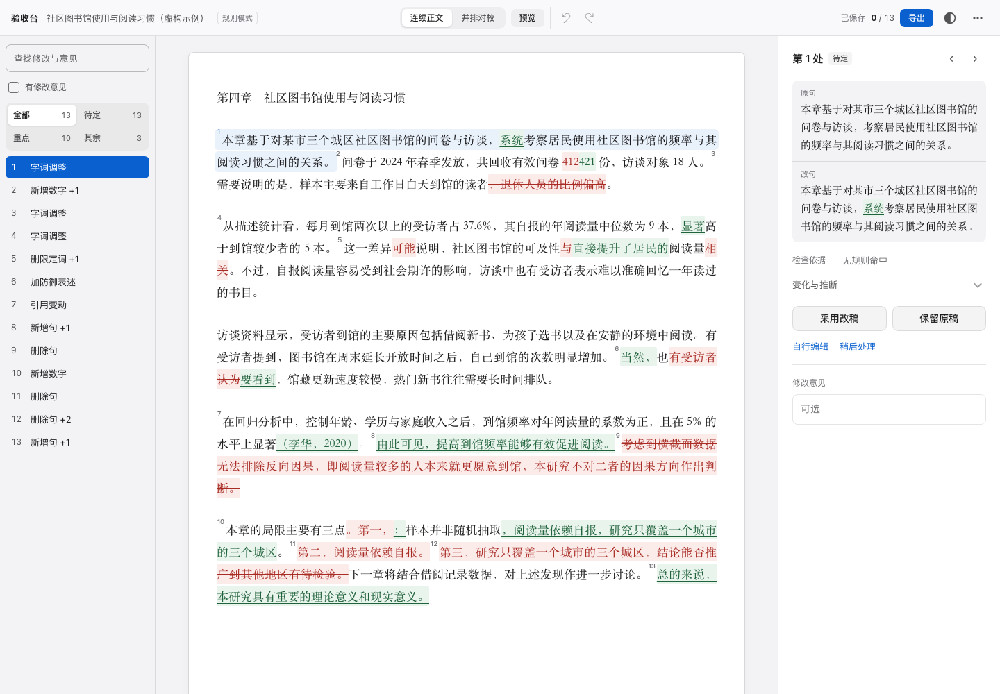

<h1 align="center">Acceptance Desk</h1>

<p align="center">Review AI edits to Chinese manuscripts, with the original text and your decisions in view.</p>

<p align="center">
  <a href="#quick-start">Quick start</a>
  · <a href="#run-from-source">Run from source</a>
  · <a href="docs/workbench.md">Workbench guide</a>
  · <a href="README.md">简体中文</a>
</p>

<p align="center">
  <a href="docs/workbench.md">
    <picture>
      <source media="(prefers-color-scheme: dark)" srcset="docs/screenshots/wb_frontend_20261115_dark.png">
      
    </picture>
  </a>
</p>

## Features

- **Compare drafts in context.** Review additions, deletions, and rewrites side by side. Check changes to numbers, citations, and wording.
- **Decide on each edit.** Accept the revision, keep the original, or edit it yourself. Undo decisions, leave notes, and save your place.
- **Carry feedback into the next draft.** Export the final text, review record, and feedback. The desktop preview can also send the manuscript and feedback to a model you choose after you review the request.

## Quick start

1. Open Acceptance Desk. Try the built-in sample, or paste or import two UTF-8 versions of a manuscript (TXT or Markdown).
2. Open the side-by-side view. Pick a change, accept the revision or keep the original, and add a note if needed.
3. Preview the merged draft and export the final text and review record. You can also save your progress and resume later.

Review and export run locally. The desktop app sends the manuscript and feedback to your selected model connection only after you confirm a request to generate the next draft.

### Try one edit

| Original manuscript | AI revision |
| --- | --- |
| 问卷结果**可能**说明，线上讨论频率与期末成绩**相关**。 | 问卷结果说明，线上讨论频率**直接导致**了期末成绩的提升。 |

The original reports an association. The revision claims that participating more often *caused* grades to improve. Open the [fictional sample pair](examples/) to review the change alongside the surrounding paragraph.

## Run from source

Install [uv](https://docs.astral.sh/uv/) and run these commands from the repository root. The local workbench listens at `http://127.0.0.1:8780`.

```bash
uv sync --locked --extra web
uv run --locked --extra web python -m workbench
```

### Command line

Print a summary of edits to the sample manuscript.

```bash
uv run --locked acceptance-desk examples/original.txt examples/revised.txt --brief
```

## Feedback and development

When reporting a problem, include the platform, build number, and steps to reproduce it with a fictional manuscript.

[Report schema](docs/schema.md) · [Export formats](docs/export.md) · [Local MCP integration](docs/mcp.md) · [CI and packaging](docs/ci.md) · [Documentation](docs/README.md)

Run `uv run --locked --group dev --extra web pytest -q` for the development test suite. CI covers Python 3.10 and 3.12. For optional offline semantic features, see [model setup](experiments/step1_models.md).
