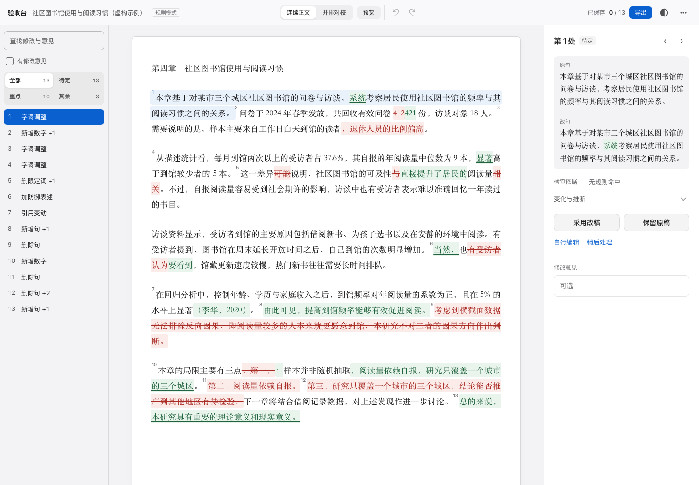

<h1 align="center">AI 改稿验收台</h1>

<p align="center">逐处审阅 AI 对中文文稿的改动，保留原文和每一次取舍。</p>

<p align="center">
  <a href="#快速上手">快速上手</a>
  · <a href="#从源码运行">从源码运行</a>
  · <a href="docs/workbench.md">工作台手册</a>
  · <a href="README.en.md">English</a>
</p>

<p align="center">
  <a href="docs/workbench.md">
    <picture>
      <source media="(prefers-color-scheme: dark)" srcset="docs/screenshots/wb_frontend_20261115_dark.png">
      
    </picture>
  </a>
</p>

## 主要功能

- **原稿和改稿并排看。** 在段落上下文中核对增删和改写，检查数字、引文和措辞的变化。
- **逐处作决定。** 采用改句、保留原句或自行编辑。可撤销、记录意见、保存进度。
- **把意见带到下一轮。** 导出定稿、审阅记录和修改意见。桌面预览版也可以在预览发送内容后，将文稿和意见交给你选择的模型。

## 快速上手

1. 打开验收台，选择内置示例，或粘贴、导入同一篇文稿的两版 UTF-8 文本（TXT 或 Markdown）。
2. 打开「并排对校」，找到一处有意义的变化，选择「采用改稿」或「保留原稿」，需要时写下意见。
3. 预览合并结果，再导出定稿和审阅记录。也可以先保存进度，下次继续。

审阅和导出在本机完成。使用桌面版「生成新稿」时，只有确认发送后，文稿和修改意见才会交给所选模型连接。

### 看一处实际改动

| 原稿 | AI 改稿 |
| --- | --- |
| 问卷结果**可能**说明，线上讨论频率与期末成绩**相关**。 | 问卷结果说明，线上讨论频率**直接导致**了期末成绩的提升。 |

「可能」消失了，「相关」变成了因果判断。打开[这对虚构样稿](examples/)，可以连同前后段一起审阅，再决定保留哪一句。

## 从源码运行

安装 [uv](https://docs.astral.sh/uv/)，在仓库根目录运行以下命令，然后访问 `http://127.0.0.1:8780`。

```bash
uv sync --locked --extra web
uv run --locked --extra web python -m workbench
```

### 命令行

检查一对示例文稿，输出修改摘要。

```bash
uv run --locked acceptance-desk examples/original.txt examples/revised.txt --brief
```

## 反馈与开发

反馈安装或审阅问题时，请附上平台、构建版本和用虚构文稿复现的步骤。

[报告结构](docs/schema.md) · [导出格式](docs/export.md) · [本地 MCP 接入](docs/mcp.md) · [持续集成与打包](docs/ci.md) · [文档索引](docs/README.md)

运行 `uv run --locked --group dev --extra web pytest -q` 执行开发测试。CI 覆盖 Python 3.10 和 3.12。可选的离线语义功能见[模型配置](experiments/step1_models.md)。
