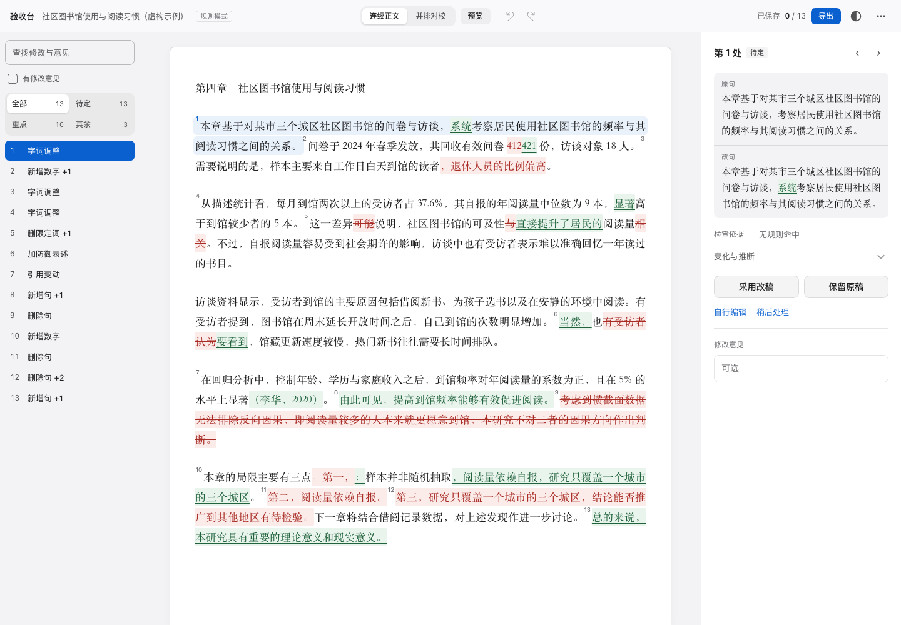
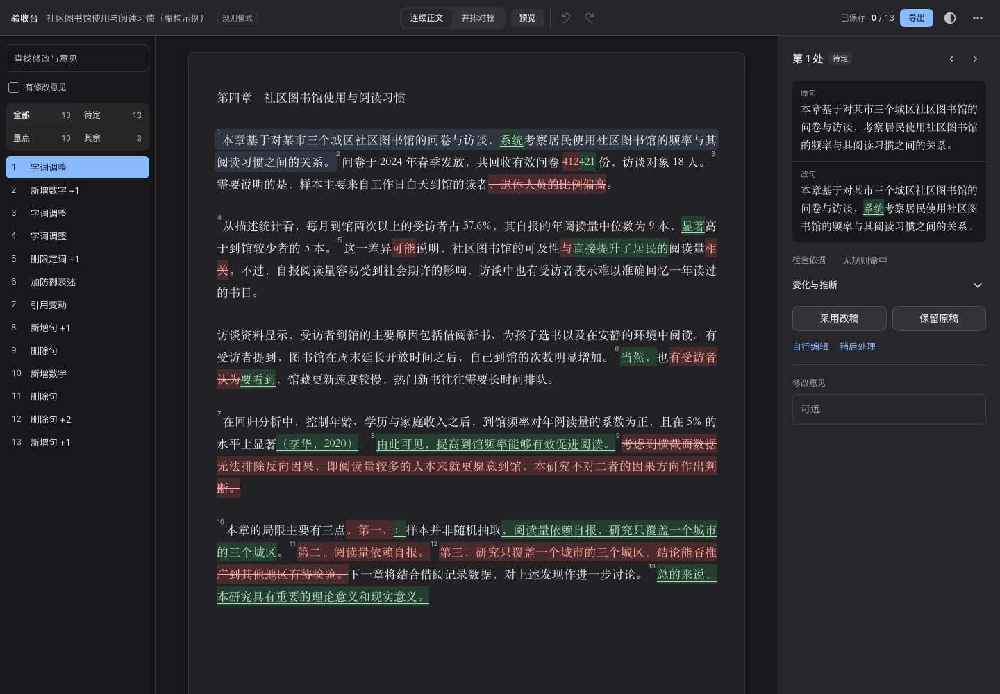

# 前端验收：外观、交互与中文撤销

外观、快捷键、自动保存和中文撤销已随 PR #60 合并。本文保留当时的回归场景和结果。

复验时使用主分支的 [本机入口](workbench.md#本机运行)，载入内置长示例。

## 人工验收

优先使用 Safari 与 macOS 自带拼音，再在 Chrome 或 Edge 检查 Ctrl 快捷键。请记录浏览器、系统、输入法，以及可重复的操作步骤。

| 场景 | 操作与预期 |
|---|---|
| 中文撤销（重点） | 在“修改意见”中分三次选词提交“你好”“世界”“继续”，中间不用刻意停顿。连续按 ⌘Z，依次得到“你好世界”→“你好”→空白；⇧⌘Z 逐次恢复。不退回候选拼音、不一次清空多次提交，文字回退应及时。Windows 对应 Ctrl+Z / Ctrl+Shift+Z，也可 Ctrl+Y 重做。 |
| 替换与编辑草稿 | 打开“自行编辑”，选中一段文字后输入中文或粘贴。撤销应恢复被替换文字及选区。⌘/Ctrl+S 提交当前编辑；直接关闭弹窗会保留草稿；“放弃草稿”才清除草稿。 |
| 保存与恢复 | 输入修改意见，停顿后应显示已保存；刷新保留意见、决定及未提交的编辑草稿。⌘/Ctrl+S 可立即保存。未选定的拼音候选内容不能作为意见落盘。刷新后撤销历史会清空。 |
| 两类历史 | 输入框内的撤销只影响文字。点击输入框外后，可通过“预览”旁的回转箭头或快捷键撤销/重做审阅决定。按钮提示应显示对应快捷键。 |
| 外观与按钮反馈 | 切换浅色、深色、跟随系统；检查正文、增删标记、输入框和弹出菜单。“预览”和“导出”应与“连续正文”滑块内按钮同为 26px 高、12px 字号，默认无描边；导出保留强调色。逐个检查按钮的悬停、按下、键盘焦点、选中及禁用状态，文字和背景应清晰，无蓝黑叠色或过大的勾选标记。 |
| 页面放大与窄窗 | 用 ⌘/Ctrl + 加号逐步放大，或缩窄窗口。左栏字段不挤成一团；窄屏通过“修改目录”展开目录，选择后收起，Esc 可关闭。 |
| 筛选与搜索 | 顺序为“全部 / 待定 / 重点 / 其余”。查找原句、改句或意见，切换“有修改意见”；结果和数量应一致，输入意见时光标保持稳定。 |
| 预览与导出 | 预览应包含已提交的自行编辑结果。右上角统一通过“导出”取得终稿/草稿、修改意见及进度，避免两个按钮弹出同一面板。按面板说明确认待定处的处理方式。 |

如果出现卡顿，请注明发生在拼音候选、按下撤销、自动保存，还是切换修改时。截图或录屏请只使用虚构示例。

## PR #60 的验证结果

- Python 全套测试：986 通过，9 项因缺少可选模型权重而跳过。
- 浏览器回归：快速多次中文提交、逐步撤销/重做、emoji 选区恢复、候选内容隔离、保存与刷新、草稿、筛选、预览和导出均通过；浅色/深色及 390–1440 像素宽度未发现横向溢出或页面错误。
- 普通输入和撤销期间，目录、进度条与历史按钮在固定回归场景中的重复重建次数由各 12 次降到 0。
- Safari + macOS 自带拼音已由本机用户实测确认：“已明显顺畅，撤销粒度也正常”。请在测试者自己的环境复验。
- 本轮仅更新前端及配套测试/构建说明。手写程序逻辑为 Python；浏览器适配由 Python 编译生成，正常运行不依赖编译器或外网。

维护者可运行独立浏览器回归（需要已安装的 Chrome）：

```bash
uv run --with playwright python tools/check_prose_editor.py --url http://127.0.0.1:8780
```

## 界面对比

此前：[并排对校原版](screenshots/wb_comparison_v2.jpg)、[优化前页面](screenshots/wb_before_polish.jpg)。

工具栏尺寸收紧前：[上一版截图](screenshots/wb_frontend_20261115_before_compact.png)。

当前浅色：



当前深色：


